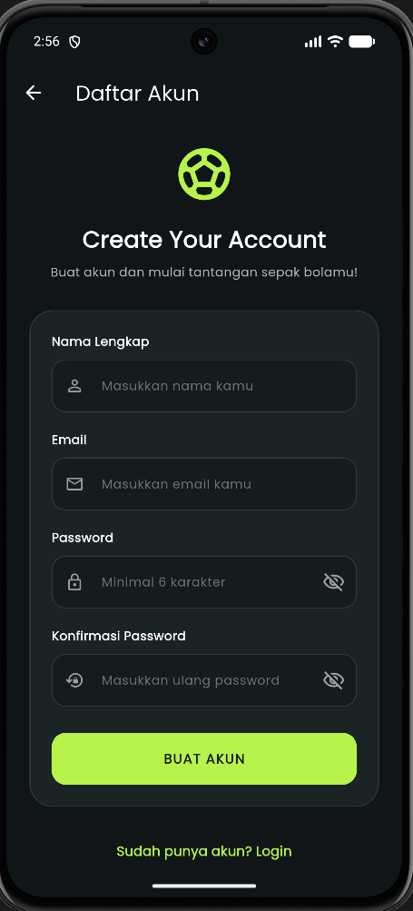
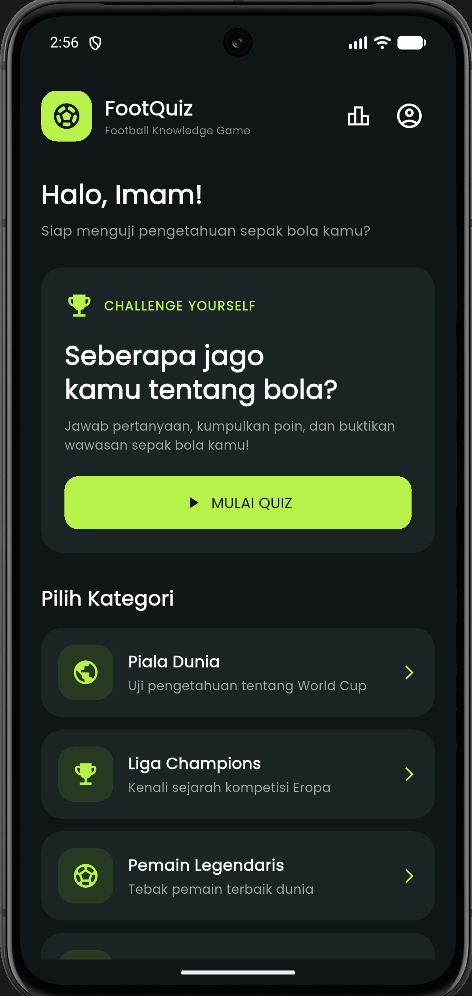
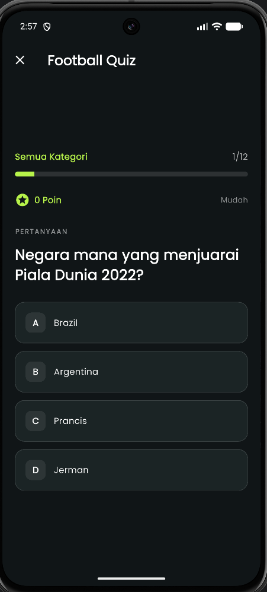
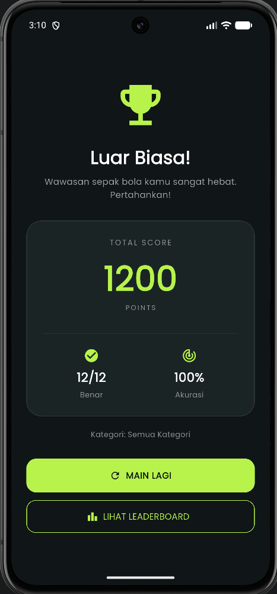
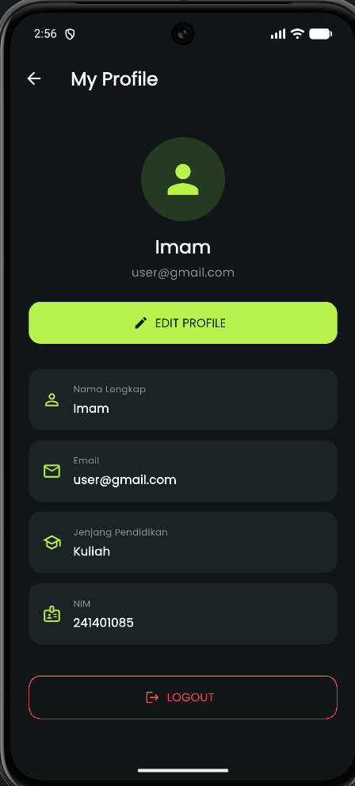
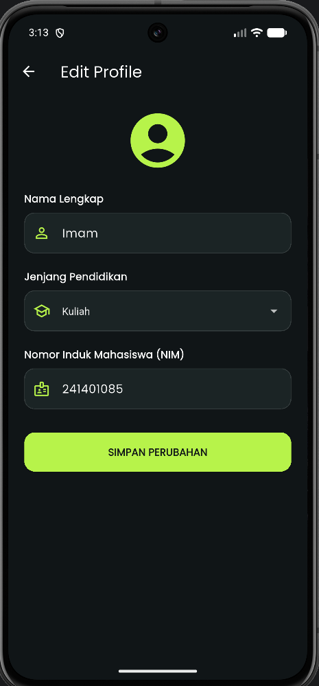
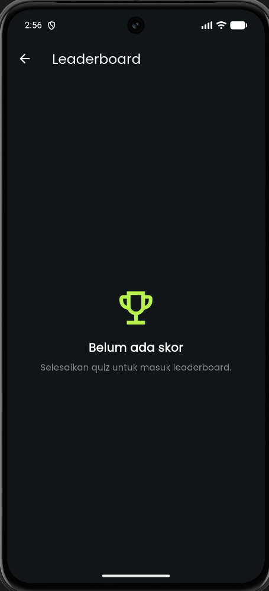

# ⚽ FOOTBALL QUIZ
### Aplikasi Kuis Pengetahuan Sepak Bola Berbasis Flutter

Football Quiz merupakan aplikasi kuis interaktif berbasis Flutter yang dirancang untuk menguji dan meningkatkan pengetahuan pengguna mengenai dunia sepak bola. Aplikasi ini menyediakan berbagai pertanyaan seputar sepak bola dengan tampilan menarik dan fitur interaktif.

---

## 👨‍🎓 Identitas Mahasiswa

| Keterangan | Informasi |
|---|---|
| Nama | Muhammad Imam Al Bukhori |
| NIM | 241401085 |
| Laboratorium | Lab 2 Pemrograman Mobile |
| Program Studi | Ilmu Komputer |
| Universitas | Universitas Sumatera Utara |

---

## 📱 Fitur-Fitur Aplikasi

1. **Login dan Register**  
   Pengguna dapat membuat akun dan masuk ke dalam aplikasi.

2. **Quiz Sepak Bola**  
   Pengguna dapat menjawab berbagai pertanyaan seputar dunia sepak bola.

3. **Profile**  
   Pengguna dapat melihat informasi profil pribadi.

4. **Edit Profile**  
   Pengguna dapat mengubah nama, memilih jenjang pendidikan (SD, SMP, SMA, Kuliah, atau Kerja), serta mengisi NIM khusus untuk mahasiswa.

5. **Leaderboard / Podium**  
   Menampilkan peringkat pemain berdasarkan skor yang diperoleh.

6. **Interactive Quiz Result**  
   Menampilkan hasil kuis, jumlah jawaban benar, skor, dan akurasi dengan tampilan interaktif serta animasi.

---

## 🛠️ Teknologi yang Digunakan

- Flutter
- Dart
- Visual Studio Code
- Android Studio
- Git
- GitHub
- Shared Preferences

---

## 📸 Dokumentasi Aplikasi

Berikut merupakan dokumentasi tampilan dari aplikasi Football Quiz.

### 1. Halaman Login


### 2. Halaman Register



### 3. Halaman Utama



### 4. Halaman Quiz



### 5. Halaman Hasil Quiz



### 6. Halaman Profile



### 7. Halaman Edit Profile



### 8. Halaman Leaderboard



---

## 🎨 Mockup / Prototype Aplikasi

Link Figma / Prototype:

--

---

## 🙏 Credits dan Sumber Aset

Aplikasi Football Quiz dikembangkan menggunakan Flutter dan Dart dengan memanfaatkan beberapa library dan sumber daya berikut:

- **Ikon:** Flutter Material Icons
- **Gambar atau ilustrasi:** Aset gambar yang digunakan dalam aplikasi
- **Font:** [Google Fonts - Poppins](https://fonts.google.com/specimen/Poppins)
- **Animasi:** [Confetti Flutter Package](https://pub.dev/packages/confetti)
- **Local Storage:** [Shared Preferences](https://pub.dev/packages/shared_preferences)


---

## 🚀 Cara Menjalankan Aplikasi

### 1. Clone Repository

```bash
git clone [LINK_REPOSITORY_GITHUB]
```

### 2. Masuk ke Folder Project

```bash
cd football_quiz
```

### 3. Install Dependencies

```bash
flutter pub get
```

### 4. Jalankan Aplikasi

```bash
flutter run
```

---

## 📌 Penutup

Football Quiz merupakan aplikasi pembelajaran berbasis permainan yang bertujuan memberikan pengalaman bermain kuis sepak bola secara interaktif, menarik, dan mudah digunakan. Aplikasi ini diharapkan dapat menjadi sarana hiburan sekaligus meningkatkan wawasan pengguna mengenai dunia sepak bola.
